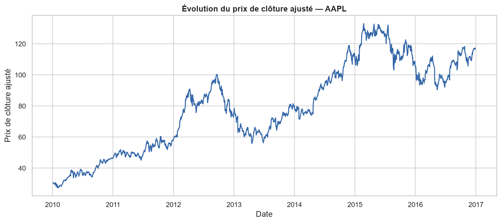
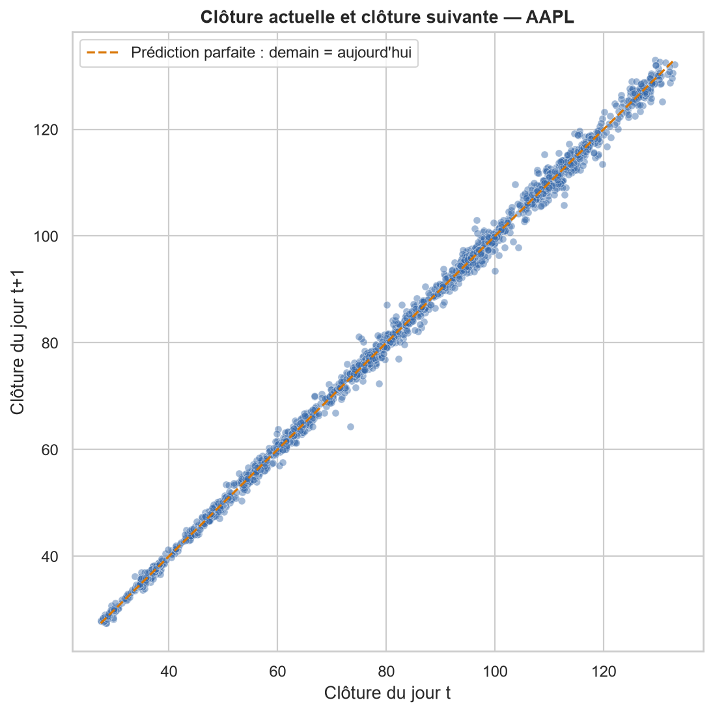
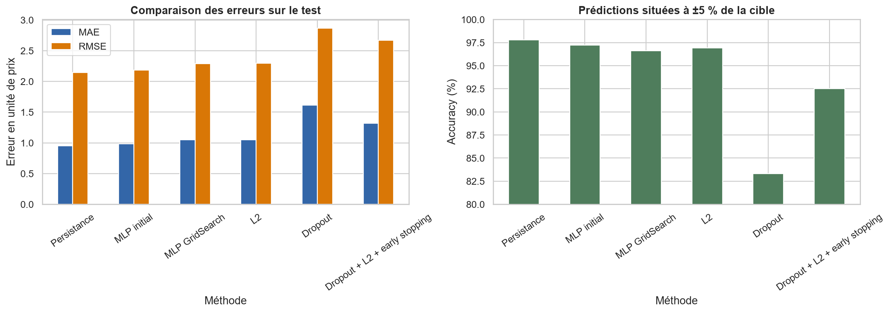
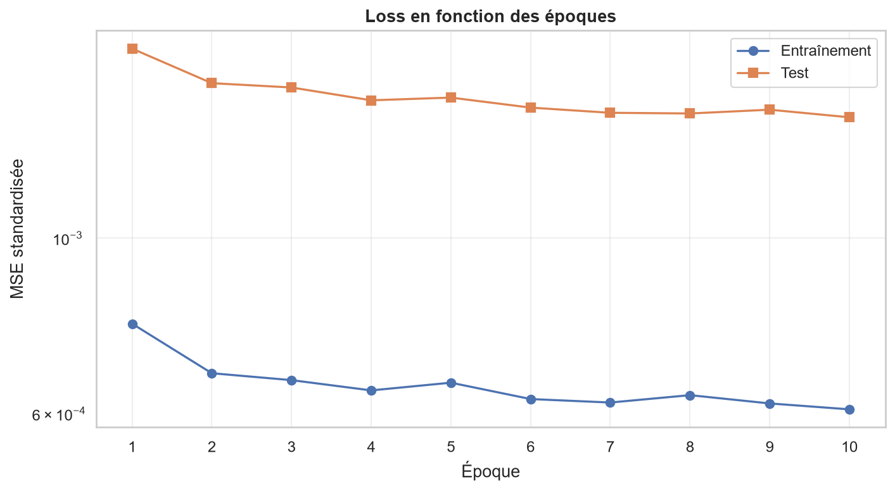
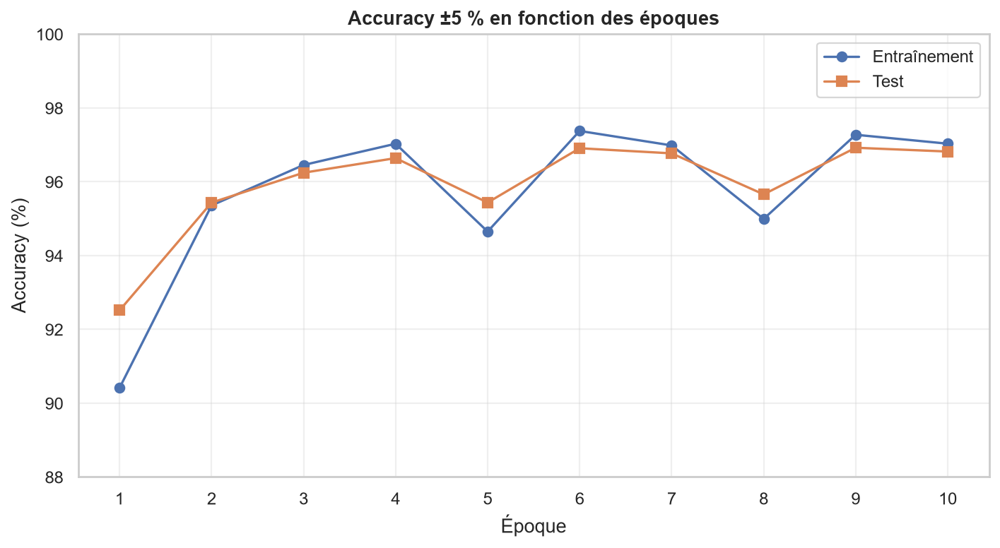

# Atelier 1 - Régression NYSE avec PyTorch

Dans ce dépôt, je présente mon travail sur la **partie 1 (régression)** de l'Atelier 1 de Deep Learning. J'étudie les prix journaliers ajustés du dataset NYSE et je compare une baseline de persistance à plusieurs réseaux de neurones PyTorch.

> Portée du rendu : j'ai finalisé uniquement la partie régression. Je ne présente pas la classification multiclasse demandée dans la partie 2 comme un travail réalisé.

J'ai conservé l'énoncé original sans modification dans `assignment/Atelier1.pdf`.

## Livrables

- [Notebook de régression entièrement exécuté](notebooks/01_regression_nyse.ipynb)
- [Rapport final au format PDF](report/final/rapport_regression_nyse.pdf)
- [Comparaison complète des modèles](outputs/metrics/regression_model_comparison.csv)
- [Résultats de la GridSearch](outputs/metrics/grid_search_results.csv)

## Problème étudié

Pour chaque action et chaque jour de cotation, je cherche à prédire le **prix de clôture ajusté du prochain jour de cotation**.

- Fichier : `prices-split-adjusted.csv`
- Variables d'entrée : `open`, `high`, `low`, `close`, `volume`
- Cible : `target_next_close`, créée par `groupby("symbol")["close"].shift(-1)`
- Taille après construction de la cible : 850 763 observations
- Modèle initial : MLP `5 -> 64 -> 32 -> 1`

## Méthodologie

J'ai réalisé un découpage strictement chronologique :

| Ensemble | Période | Observations |
|---|---|---:|
| Entraînement | 2010-01-04 au 2014-12-30 | 599 692 |
| Validation | 2015-01-02 au 2015-12-30 | 124 458 |
| Test | 2016-01-04 au 2016-12-29 | 125 624 |

J'ai reconstruit la cible à l'intérieur de chaque période pour éviter d'utiliser une valeur future située dans une autre partition. J'ai ajusté les `StandardScaler` des entrées et de la cible uniquement sur l'entraînement.

Pour la recherche d'hyperparamètres, j'ai comparé 16 configurations sur un sous-échantillon déterministe de 80 000 exemples d'entraînement et 20 000 exemples de validation. Je n'ai jamais utilisé le test pour choisir les hyperparamètres.

## Résultats sur le test

J'ai défini l'accuracy de régression comme le pourcentage de prédictions situées à ±5 % de la cible.

| Méthode | MAE | RMSE | R² | Accuracy ±5 % |
|---|---:|---:|---:|---:|
| Persistance | **0,9484** | **2,1429** | 0,9996 | **97,8109 %** |
| MLP initial | 0,9811 | 2,1839 | 0,9996 | 97,2235 % |
| MLP GridSearch | 1,0479 | 2,2899 | 0,9995 | 96,6042 % |
| L2 | 1,0480 | 2,2937 | 0,9995 | 96,9218 % |
| Dropout | 1,6114 | 2,8647 | 0,9992 | 83,3312 % |
| Dropout + L2 + early stopping | 1,3192 | 2,6681 | 0,9993 | 92,5197 % |

J'observe que la baseline de persistance reste la meilleure. Mon MLP initial obtient un résultat proche, mais sa complexité n'est pas justifiée par un gain de performance. Les courbes train/test ne montrent pas de divergence progressive sur dix époques. Dans mes expériences, la régularisation n'aide pas ; le dropout provoque même un sous-apprentissage marqué.

J'interprète le R² très élevé avec prudence : le niveau du prix au jour `t+1` est naturellement très proche de celui du jour `t`. Prédire correctement les variations ou les rendements serait une tâche plus difficile.

## Visualisations principales

### Évolution du prix de clôture ajusté de l'action AAPL



### Clôture actuelle et clôture du prochain jour



### Comparaison des modèles



### Loss et accuracy en fonction des époques





## Reproduire le travail sous Windows

Dans PowerShell :

```powershell
cd "$env:USERPROFILE\Desktop\DL-Lab-1"
.\setup.ps1
.\.venv\Scripts\python.exe .\scripts\download_data.py
.\start_lab.ps1
```

Dans Jupyter, ouvrir puis exécuter :

```text
notebooks/01_regression_nyse.ipynb
```

Pour produire ces résultats, j'ai utilisé Python 3.12, PyTorch 2.5.1 avec CUDA 12.1 et une RTX 3070. Mon notebook utilise automatiquement le CPU si CUDA n'est pas disponible.

Google Colab et Kaggle sont mentionnés dans l'énoncé comme environnements d'exécution possibles. Pour ce rendu, j'ai réalisé tous les entraînements et toutes les évaluations localement sous Windows avec mon GPU personnel ; aucun de mes résultats ne provient d'un notebook Colab ou Kaggle.

## Fichiers importants

```text
DL-Lab-1/
|-- assignment/Atelier1.pdf
|-- notebooks/
|   `-- 01_regression_nyse.ipynb
|-- outputs/
|   |-- figures/
|   `-- metrics/
|-- report/final/
|-- scripts/
|-- requirements.txt
|-- setup.ps1
`-- start_lab.ps1
```

J'exclus de Git les données brutes, les tableaux NumPy intermédiaires, les poids des modèles et l'environnement virtuel. Je versionne les métriques, les figures et le rapport final afin que mes résultats restent consultables sans relancer l'entraînement.

## Synthèse personnelle

Ce travail m'a permis de consolider :

- la lecture et le contrôle d'un DataFrame pandas ;
- la différence entre variables d'entrée et cible ;
- la création d'une cible temporelle sans mélanger les actions ;
- le découpage chronologique train/validation/test ;
- la standardisation sans fuite de données ;
- les tensors, mini-batches, couches cachées, loss, gradients et optimiseur dans PyTorch ;
- l'intérêt d'une baseline simple et l'interprétation de l'overfitting ;
- la recherche d'hyperparamètres et les limites d'une recherche sur sous-échantillon ;
- les effets de L2, du dropout et de l'early stopping.
